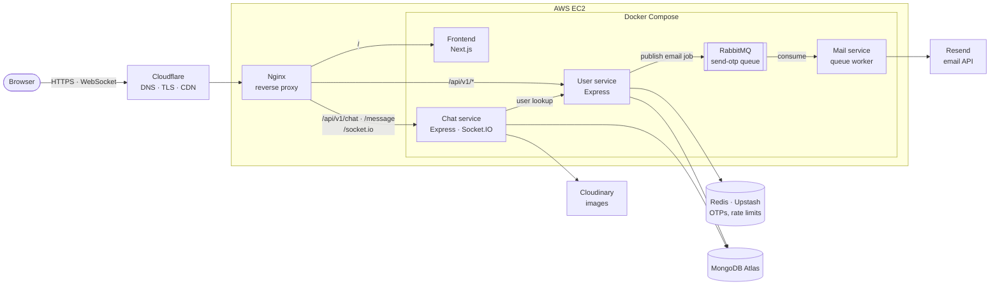
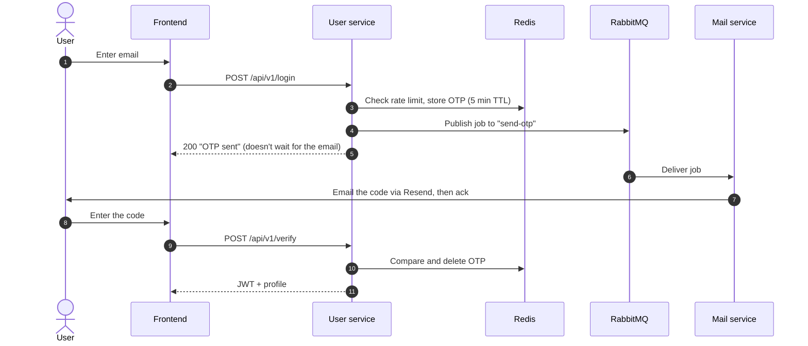
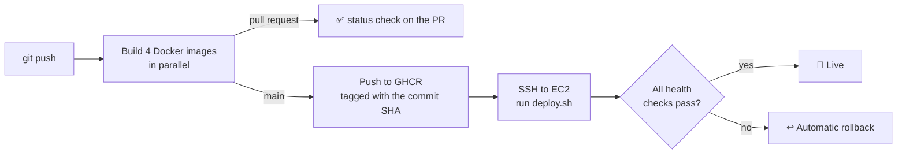

<div align="center">

# 💬 Chatter

**A real-time chat app built as event-driven Node.js microservices, deployed on AWS through a GitHub Actions CI/CD pipeline.**

[**Live demo → chatter-t.me**](https://chatter-t.me) · [Architecture](#architecture) · [CI/CD](#cicd-pipeline) · [Run locally](#run-locally)

[](https://github.com/himanshur4/chatter/actions/workflows/ci-cd.yml)


</div>

<!-- Add a screenshot or GIF of two users chatting here, e.g.  -->

## Features

- **Passwordless login.** A 6-digit code is emailed to you. Codes expire after 5 minutes, and requests are rate-limited to one per minute per email (Redis). Sessions use JWTs.
- **Real-time messaging.** 1:1 conversations are delivered instantly over WebSockets (Socket.IO).
- **Presence and typing indicators.** You see live online/offline status and "typing…" as the other person types.
- **Read receipts.** Messages show ✓ when sent and ✓✓ when seen, and the sender's screen updates live. A message is marked seen immediately if the recipient already has the chat open.
- **Unread badges.** Each conversation shows an unread count, and active conversations move to the top.
- **Image sharing.** Images are stored on Cloudinary and resized and compressed automatically (5 MB limit).
- **Asynchronous email.** OTP emails go through a RabbitMQ queue, so login responds instantly even when the email provider is slow.
- **Responsive UI.** Built with Next.js, Tailwind CSS and shadcn/ui, with a sidebar layout on desktop and list/detail navigation on mobile.

## Architecture



| Service | Responsibility |
|---|---|
| **frontend** | Next.js UI. Calls the APIs over REST and holds a WebSocket to the chat service |
| **user** | OTP login, JWT issuing, profiles, user directory. Publishes email jobs to RabbitMQ |
| **chat** | Conversations, messages, image uploads, real-time events (Socket.IO) |
| **mail** | RabbitMQ consumer that sends OTP emails through Resend |
| **rabbitmq** | Durable queue that decouples the user service from email delivery |

### Event-driven login



## Tech stack

| Layer | Technologies |
|---|---|
| Frontend | Next.js 16 (App Router), React 19, TypeScript, Tailwind CSS 4, shadcn/ui, Socket.IO client |
| Backend | Node.js 24, Express 5, TypeScript, Socket.IO, Prisma ORM, amqplib, JWT, Multer |
| Data & messaging | MongoDB Atlas, Redis (Upstash), RabbitMQ |
| External services | Cloudinary (image storage), Resend (email) |
| DevOps | Docker, Docker Compose, GitHub Actions, GitHub Container Registry, AWS EC2, Nginx, Cloudflare |

## CI/CD pipeline



- **Every pull request** builds all four images, which type-checks the TypeScript and runs the production Next.js build, so broken code never reaches `main`.
- **Every push to `main`** publishes immutable images tagged with the commit SHA and deploys them to EC2 over SSH.
- **Health-gated releases:** a deploy only succeeds once every container reports healthy. Otherwise the previous version is restored automatically.
- **No manual steps:** secrets are stored in GitHub Actions and written to the server at deploy time, so nothing sensitive lives in the repo.

See [docs/CI-CD.md](docs/CI-CD.md) for a walkthrough of the pipeline and [docs/DEPLOYMENT.md](docs/DEPLOYMENT.md) for server setup.

## Engineering highlights

- **Decoupled email delivery.** The user service publishes to a durable RabbitMQ queue as persistent messages, and the mail service acknowledges a job only after the email is sent. Queued emails survive restarts of either service or of RabbitMQ itself.
- **Self-healing connections.** Services retry with exponential backoff until RabbitMQ is reachable, and reconnect automatically if it restarts. Containers restart on failure and after reboots.
- **Least-privilege networking.** Container ports are bound to `127.0.0.1`, so they're reachable only from the server itself. Nginx, behind Cloudflare, is the single public entry point.
- **Lean, non-root images.** Multi-stage builds ship only production dependencies (plus Next.js standalone output for the frontend), and every app runs as an unprivileged user.
- **Room-aware read receipts.** If the recipient is viewing the conversation when a message arrives, the chat service stores it as already seen and notifies the sender instantly.

## Run locally

**Prerequisites:** Docker, Node.js 24, and free accounts on MongoDB Atlas, Upstash (or any Redis), Cloudinary and Resend.

```bash
git clone https://github.com/himanshur4/chatter.git && cd chatter

cp .env.example .env                 # RabbitMQ login for docker compose
# Create backend/user/.env, backend/chat/.env and backend/mail/.env from their .env.example files

docker compose up --build            # builds and starts everything → http://localhost:3000
```

<details>
<summary>Prefer hot reload? Run the services with npm instead</summary>

```bash
docker compose up -d rabbitmq        # RabbitMQ only (dashboard: http://localhost:15672)

# in each of backend/user, backend/chat, backend/mail and frontend:
npm install && npm run dev
```

</details>

## Project structure

```text
chatter/
├── frontend/                 Next.js app (pages, components, Socket.IO client)
├── backend/
│   ├── user/                 Auth, OTP, profiles; publishes email jobs
│   ├── chat/                 Chats, messages, image uploads, Socket.IO server
│   └── mail/                 RabbitMQ consumer that sends emails
├── docker-compose.yml        The full stack: 4 services + RabbitMQ
├── deploy/deploy.sh          Runs on EC2: pull, health-check, roll back on failure
├── .github/workflows/        CI/CD pipeline
└── docs/                     Pipeline walkthrough and deployment guide
```

<details>
<summary><b>API reference</b></summary>

🔒 = requires `Authorization: Bearer <JWT>`

**User service**

| Method | Endpoint | Description |
|---|---|---|
| POST | `/api/v1/login` | Email a one-time code |
| POST | `/api/v1/verify` | Verify the code and return a JWT and the user |
| GET | `/api/v1/me` 🔒 | Current user |
| PUT | `/api/v1/update/user` 🔒 | Change display name |
| GET | `/api/v1/user/all` 🔒 | List users (to start a chat) |
| GET | `/api/v1/user/:id` | Get one user (used by the chat service) |

**Chat service**

| Method | Endpoint | Description |
|---|---|---|
| POST | `/api/v1/chat/new` 🔒 | Open (or reuse) a 1:1 conversation |
| GET | `/api/v1/chat/all` 🔒 | My conversations with last message and unread count |
| POST | `/api/v1/message` 🔒 | Send text and/or an image (`multipart/form-data`) |
| GET | `/api/v1/message/:chatId` 🔒 | Conversation history (marks messages as seen) |

**Socket.IO events:** `getOnlineUser`, `newMessage`, `messagesSeen`, `typing` / `stopTyping` → `userTyping` / `userStoppedTyping`, `joinChat` / `leaveChat`

</details>

---

<div align="center">Built by <a href="https://github.com/himanshur4">Himanshu</a></div>
