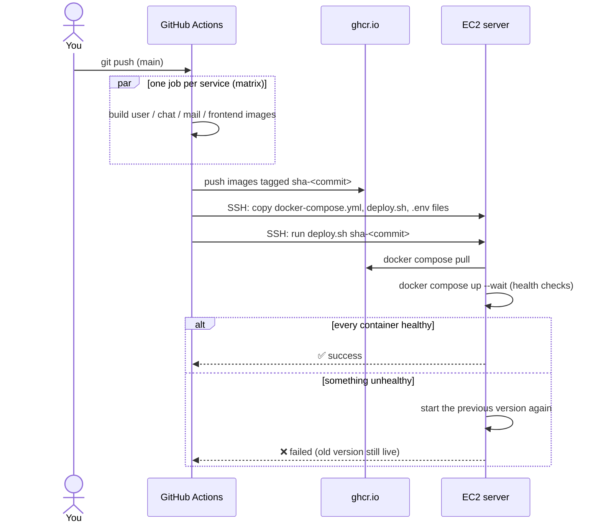

# How the CI/CD pipeline works

This explains the pipeline from first principles: what CI/CD is, the few Docker and GitHub Actions concepts it relies on, what happens on every push, and why it's designed this way. For setup steps, see [DEPLOYMENT.md](DEPLOYMENT.md).

## The problem

Deploying by hand means SSH-ing into the server and typing the same commands every time: `git pull`, `npm install`, `npm run build` in four folders, then restarting everything. It's slow and easy to get wrong. If a build fails halfway, the live site breaks while you debug. The RabbitMQ server existed only because someone once typed a `docker run` command, which nobody could reproduce.

## Three ideas

- **Continuous Integration (CI).** Every change is built and checked automatically as soon as it's pushed. Broken code is caught on GitHub, not on your server.
- **Continuous Deployment (CD).** Every change that passes CI is released to production automatically.
- **GitHub Actions** is GitHub's built-in automation service. You describe a *workflow* in a YAML file under `.github/workflows/`. When something happens (for example, a push), GitHub starts a fresh virtual machine called a *runner*, runs your steps on it, and then deletes the machine.

| Term | Meaning | In this repo |
|---|---|---|
| Workflow | One automation, defined in one YAML file | `.github/workflows/ci-cd.yml` |
| Trigger (`on:`) | The events that start it | A push or pull request to `main`, or the manual "Run workflow" button |
| Job | A group of steps that runs on one runner. Jobs run in parallel unless one `needs:` another | `build`, `deploy` |
| Step | One shell command (`run:`) or one reusable action (`uses:`) | "Build image", "Deploy" |
| Action | A reusable step that someone published | `actions/checkout`, `docker/build-push-action` |
| Matrix | Runs the same job several times with different values | `build` runs once each for user, chat, mail and frontend |
| Secret | An encrypted setting, masked in logs | `EC2_SSH_KEY`, `USER_ENV`, … |
| Variable | A plain, non-secret setting | `DEPLOY_ENABLED`, `SITE_URL` |

## Docker in two minutes

- An **image** is your app packaged together with Node.js and its dependencies, so it runs the same everywhere. It's built from a recipe called a **Dockerfile**.
- A **container** is a running copy of an image.
- A **registry** stores images, the way npm stores packages. This project uses GHCR (GitHub Container Registry, `ghcr.io`).
- **Docker Compose** describes every container in one file (`docker-compose.yml`): which images to run, their settings, how they connect, and their health checks. `docker compose up` starts the whole stack.

The payoff is that the server no longer needs Node.js, npm, PM2 or a build step. It downloads ready-made images and runs them. RabbitMQ, which used to be a one-off manual command, is now a few declared lines in `docker-compose.yml` with a volume that keeps its data.

## What happens when you push

**1. Build job** (4 copies in parallel, one per service):

1. `actions/checkout` downloads the code onto the runner.
2. `docker/setup-buildx-action` prepares Docker's builder.
3. `docker/login-action` logs in to ghcr.io with the run's automatic `GITHUB_TOKEN`. This step is skipped on pull requests.
4. `docker/build-push-action` builds the image from the service's Dockerfile. Inside, that runs `npm ci`, `prisma generate` and `tsc` (or `next build`). **This is the CI check:** a type error or a broken build fails right here.
5. On `main`, the image is pushed as `sha-<commit>` and `latest`. Layers that didn't change are reused from the cache, so rebuilds take seconds.

On a pull request the same builds run but nothing is pushed or deployed. You only get a ✅ or ❌ on the PR.

**2. Deploy job** (only on `main`, only if all four builds passed, only if `DEPLOY_ENABLED` is `true`):

1. Fails early with a clear message if any required secret is missing.
2. Writes the SSH key and connects to EC2.
3. Turns the `USER_ENV` / `CHAT_ENV` / `MAIL_ENV` secrets into `.env` files readable only by their owner, and copies them with `docker-compose.yml` and `deploy.sh` to `~/chatter-prod`.
4. Logs the server in to ghcr.io with a token that expires when the job ends, runs `deploy.sh`, then logs it out again.
5. Requests the public site to confirm it responds.

**3. `deploy.sh`** (runs on the server):

1. On the very first deploy, refuses to continue if the old setup still holds the ports.
2. `docker compose pull` downloads the new images and checks they match the server's CPU type.
3. `docker compose up --wait` replaces the containers and waits until every health check passes. Each app answers on `/health`, and RabbitMQ is checked with `rabbitmq-diagnostics ping`.
4. On success, it records the deployed tag and cleans up old images. On failure, it starts the previous tag again and exits with an error, so the run shows ❌ while the old version keeps serving traffic.

## Design decisions

| Decision | Why |
|---|---|
| Build on GitHub, not on the server | The EC2 instance is small. Building Next.js there is slow and can exhaust its memory while it's serving users. GitHub's runners are free for public repositories |
| Tag every image with the commit SHA | Releases are immutable and traceable: you always know which commit is live, and rolling back means running an older tag |
| Health checks + `--wait` + automatic rollback | A release only counts once every container is healthy, so a bad commit can't take the site down |
| Secrets in GitHub, `.env` files written at deploy time | The repository is public. Secrets never touch git, and they're masked in logs |
| Container ports bound to `127.0.0.1` | Only Nginx on the same machine can reach the apps. RabbitMQ and its dashboard are no longer exposed to the internet |
| `DEPLOY_ENABLED` switch | The pipeline can build safely before the server is ready, and deploys can be paused without editing code |
| RabbitMQ auto-reconnect in the services | After a reboot containers start in any order, so the services retry until RabbitMQ is up and reconnect if it restarts |
| Multi-stage Dockerfiles, non-root user | Build tools stay out of the final image, which makes it smaller and leaves less to attack |

## File tour

| File | What it does |
|---|---|
| [`.github/workflows/ci-cd.yml`](../.github/workflows/ci-cd.yml) | The pipeline: triggers, the build matrix and the deploy job |
| [`backend/*/Dockerfile`](../backend/user/Dockerfile), [`frontend/Dockerfile`](../frontend/Dockerfile) | How each image is built: a *build* stage with all the tools, then a small *run* stage with only what's needed |
| `*/.dockerignore` | Files that never go into an image: `node_modules`, `.env`, keys |
| [`docker-compose.yml`](../docker-compose.yml) | All five containers: images, ports, health checks, restart policy, log limits, RabbitMQ volume |
| [`deploy/deploy.sh`](../deploy/deploy.sh) | The server side of a deploy, including rollback |
| `.env.example` files | The settings each part needs, with placeholder values |
